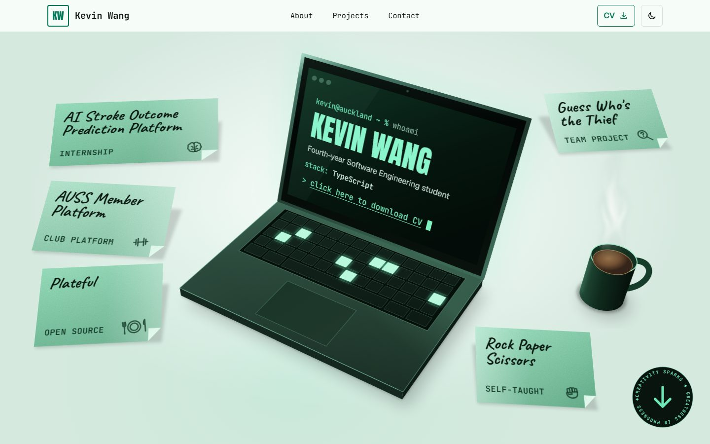

# Kevin Wang — portfolio

My personal portfolio: who I am, what I've built, and how to reach me. I'm Kevin Wang (Wangxun Wang), a fourth-year Software Engineering student at the University of Auckland.

**Live:** [personal-website-two-gray-19.vercel.app](https://personal-website-two-gray-19.vercel.app)

<picture>
  <source media="(prefers-color-scheme: dark)" srcset="docs/screenshot-dark.jpg">
  
</picture>

## What's inside

- **A drawn desk scene for the hero.** [`scripts/desk-scene.py`](scripts/desk-scene.py) projects a small 3D model (laptop, mug, sticky notes) through one camera into an SVG, and writes matching CSS 3D transforms so the real HTML on top (the name, the CV link, the project notes) sits in the same perspective. Everything you can read or click is HTML, not part of the picture.
- **Motion that stays out of the way.** CSS scroll-driven animations, a typing laptop, card-to-case-study morphs with React's `<ViewTransition>`, and sticky notes that fly to their project card on click. All of it is off with reduced motion, and the site works fully without it.
- **Light and dark themes** that follow the system until you pick one, with no flash of the wrong theme on load.
- **Static, typed content.** Projects and profile live in TypeScript files; each case study is a prerendered page with its own generated Open Graph image.
- **A real 404.** Unknown URLs, including unknown case studies, return a 404 status with the site's own page (via [`src/proxy.ts`](src/proxy.ts)).
- **Accessible and fast.** Keyboard navigable with visible focus, checked with axe in CI in both themes; Lighthouse 100 for accessibility, best practices and SEO, and 100 desktop performance.

## Stack

[Next.js 16](https://nextjs.org) (App Router, Cache Components) · React 19 · TypeScript (strict) · [Tailwind CSS 4](https://tailwindcss.com) · [Playwright](https://playwright.dev) + [axe](https://github.com/dequelabs/axe-core-npm) for tests · deployed on Vercel, with GitHub Actions running lint, build and tests on every pull request.

No CMS, database or UI library.

## Run it locally

Needs Node.js 24 and npm.

```bash
npm install
npm run dev        # http://localhost:3000
```

| Command | What it does |
| --- | --- |
| `npm run dev` | Development server |
| `npm run build` | Production build |
| `npm run lint` | ESLint |
| `npm test` | Smoke tests (Playwright + axe) against the production build |

Before the first `npm test`, install the test browser once with `npx playwright install chromium`, and run `npm run build` before each test run.

## Project layout

```
src/
  app/            pages, layout, metadata, Open Graph images, 404
  components/     header, footer, hero scene and its overlays, motion helpers
  content/        profile.ts and projects.ts: all the site's text and links
  proxy.ts        404 status for unknown case studies
scripts/
  desk-scene.py   generates the hero's DeskScene.tsx and deskAnchors.ts
tests/
  smoke.spec.ts   end-to-end and accessibility checks
```

## Editing content

- Text, links and skills: [`src/content/profile.ts`](src/content/profile.ts).
- Projects and case studies: [`src/content/projects.ts`](src/content/projects.ts). Screenshots go in `src/content/images/`.
- A new project also needs a spot for its sticky note on the desk: add it to `NOTES` in `scripts/desk-scene.py`, then regenerate the scene with `python scripts/desk-scene.py` (Python 3, standard library only).
